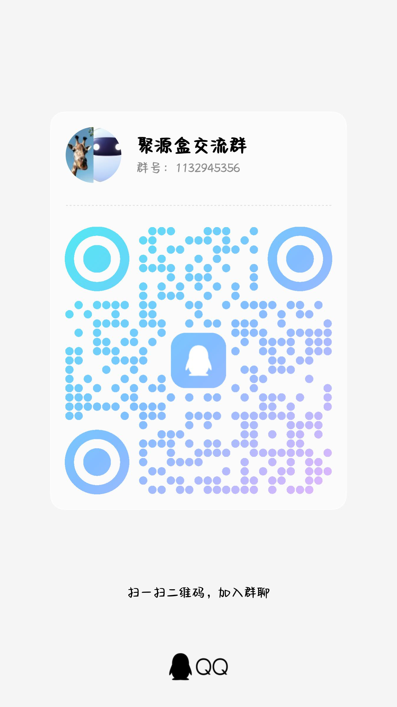

# 聚源盒 · JuYing Box

一个基于 **HarmonyOS NEXT** 原生开发的聚合影视播放应用（ArkTS / ArkUI）。

> 本应用不内置、不存储、不上传任何影视内容，所有内容均来自用户自行配置的第三方订阅站点，仅供学习交流使用。

## ✨ 功能特性

- **多源聚合**：支持导入聚合源订阅配置（含 JPEG 伪装 → 去盐 → Base64 → JSON5 四层解码链），站点可自由增删管理
- **多协议站点引擎**：
  - CMS 标准接口（JSON API / XML CMS）
  - AppYs（苹果CMS V10 应用型接口）
  - XBPQ 规则网页站
  - JS 插件（type 3，Web 容器内运行 JS 爬虫运行时）
  - 外部 `csp_*` JAR 爬虫（通过本地 JAR 代理服务器支持，见下文）
- **播放器**：
  - 全屏 / 影院模式，屏幕跟随手机旋转
  - 左右半屏竖滑调节亮度 / 音量
  - 进度条可拖可点（松手才 seek）
  - 画面按真实宽高比适配，竖屏片不拉伸
  - **换源续播**：换源后按片名 + 集号自动回退上次播放位置
  - HLS 广告切片过滤
  - 链接嗅探（Sniff Proxy）
- **投屏**：基于 AVSession 投播会话 + 系统设备选择器
- **弹幕**：
  - 多数据源自动回退：danmu_api 聚合（爱优腾芒哔咪等 16 站，自部署免费）→ 弹弹play（内置凭据位）→ B 站匿名链路（零配置）
  - 按剧名 + 集号自动匹配分 P，失败自动尝试下一数据源
  - Canvas 渲染：滚动 / 顶部 / 底部弹幕、泳道避让、半透明不挡画面、平滑渲染时钟不卡顿
  - 弹幕面板：手动搜索选库、时间偏移微调、开关即时生效
- **跳过片头 / 片尾**：播放中点按钮就地标记片头结束点与片尾长度，**按剧记忆**；后续集起播自动跳片头、播到片尾自动连播下一集，时长不用选、每部剧各记各的
- **下载**：底部弹层面板，每 21 集分页 tab，点哪集下哪集；直链（request.agent）与 HLS 分片双引擎、断点续传、下载列表管理，清理时联动删除本地文件
- **直播**：m3u / php 接口 / 自定义 UA 等多种直播源解析，频道不可用自动换台
- **交互细节**：选集 / 下载 / 线路 / 倍速统一底部弹层交互，设置改动即时生效无需重启，自定义壁纸，离线影片清理联动存储统计
- **数据管理**：收藏、播放历史、搜索历史、无痕模式、运行缓存与离线影片分列管理

## 🛠 技术栈

| 项 | 说明 |
|----|------|
| 平台 | HarmonyOS NEXT（纯血鸿蒙，手机/平板） |
| 语言 | ArkTS |
| UI | ArkUI（声明式） |
| SDK | modelVersion / compile / compatible / target 均为 26.0.0 |
| IDE | DevEco Studio 6.x |
| 运行时 | Web 容器承载 JS 爬虫运行时 |
| 辅助工具 | Java 17（JAR 爬虫代理服务器） |

## 📁 项目结构

```
juying-app/
├── AppScope/                    # 应用级配置（bundleName、图标、版本）
├── entry/                       # 主模块（HAP 入口）
│   └── src/main/ets/
│       ├── pages/               # 页面：首页/搜索/详情/播放/直播/下载/历史/设置/站点管理
│       ├── components/          # 通用组件：底部导航、影片网格、选项器等
│       ├── net/                 # 网络层：HttpClient、HLS广告过滤服务、嗅探代理、JS 爬虫 CORS 代理
│       ├── spider/              # JS 爬虫驱动与 Web 桥（IDrpyBridge 契约）
│       └── state/               # 全局状态：订阅导入、收藏/历史/下载/设置、KV 存储
├── common/                      # 公共库模块
│   └── src/main/ets/
│       ├── engine/              # 站点引擎：SiteDriver、CmsJsonApi、XmlCmsDriver、AppYsApi、
│       │                        #   XbpqDriver、ProxyDriver、PlayUrlResolver
│       ├── decode/              # ConfigDecoder：外部订阅四层解码链
│       ├── model/               # 聚合源 / 影片数据模型
│       └── util/                # HLS 广告过滤、直播源解析、编解码等工具
├── tools/proxy-server/          # 外部 JAR 爬虫代理服务器（Java，独立运行）
└── hvigor/                      # 构建工具配置
```

## 🚀 快速开始

### 环境要求

- [DevEco Studio](https://developer.huawei.com/consumer/cn/deveco-studio/) 6.x 及以上
- HarmonyOS NEXT 真机（应用仅申请 `INTERNET` 权限，侧载自用）

### 构建运行

1. 克隆本仓库

```bash
git clone https://gitee.com/ZKingp/juyuan-box.git
```

2. 使用 DevEco Studio 打开项目，等待 hvigor 同步完成
3. 配置签名（File → Project Structure → Signing Configs，勾选 Automatically generate）
4. 连接真机，点击 Run 运行

### JAR 爬虫代理（可选）

订阅中的 `csp_*` Java 爬虫站点需要本地代理服务器执行，详细说明见 [`tools/proxy-server/README.md`](tools/proxy-server/README.md)：

```bash
cd tools/proxy-server
gradle jar
java -jar build/libs/proxy-server.jar <订阅地址> [端口]
```

然后在 App「设置 → JAR 代理」中填入 `http://<电脑IP>:<端口>`。

## 📖 使用说明

1. 首次使用请在 App 内导入自己的订阅配置（支持聚合源订阅格式）
2. 在「站点管理」中按需启用/停用站点
3. 底部导航：首页（点播）/ 直播 / 设置
4. 播放页支持换源、投屏、下载、收藏等操作

## 📸 截图

> 待补充：建议放 4-6 张（首页 / 播放器 / 弹幕 / 下载面板 / 直播），放到 `screenshots/` 目录后把下面占位替换为真实文件。

| 首页 | 播放器 | 弹幕 | 下载面板 |
|------|--------|------|----------|
|  |  |  |  |

## 🤝 参与贡献

1. **Issue 反馈**：问题与建议优先走 [Issues](https://gitee.com/ZKingp/juyuan-box/issues)——公开讨论、可追溯，回复也帮到其他人
2. **代码贡献**：Fork 本仓库 → 新建分支修改 → 提交 Pull Request，会尽快 review
   - 重点维护方向见功能特性列表；改 `net/`、`spider/`、构建配置的 PR 请在描述里说明动机
3. **QQ 交流群**：聊用法、交流源配置、协作开发
   - 群号：`1132945356`（QQ 搜索群号直接加入，二维码永久有效）

<p align="center">
  
</p>

## ☕ 赞赏

如果这个项目对你有帮助，欢迎请作者喝杯咖啡～**完全自愿**，不打赏不影响任何功能与支持。

<p align="center">
  
  &nbsp;&nbsp;&nbsp;&nbsp;
  
</p>

> 微信 / 支付宝扫码即可，金额随意～

## ⚠️ 免责声明

1. 本项目是基于开源技术的学习研究作品，**不内置、不存储、不上传任何影视内容**，也不提供任何内容服务。
2. 应用展示与播放的所有内容均来自用户**自行配置**的第三方站点，其合法性由内容提供方负责，与本项目无关。
3. 请在下载后 **24 小时内删除**，不得用于任何商业或非法用途。
4. 使用本项目产生的任何法律责任由使用者自行承担，作者不承担任何责任。

## 📄 许可证

本项目基于 [GPL-3.0](LICENSE) 许可证开源发布。

任何对本项目源代码的修改、分发都必须同样以 GPL-3.0 开源，请勿用于闭源商业套壳。

Copyright (C) 2026 不才
